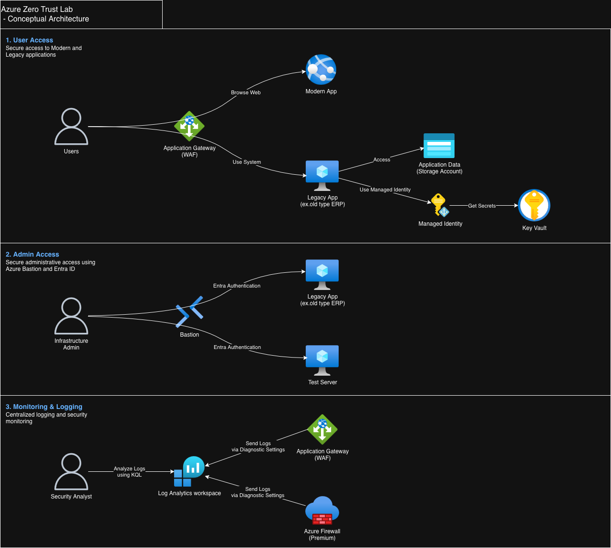
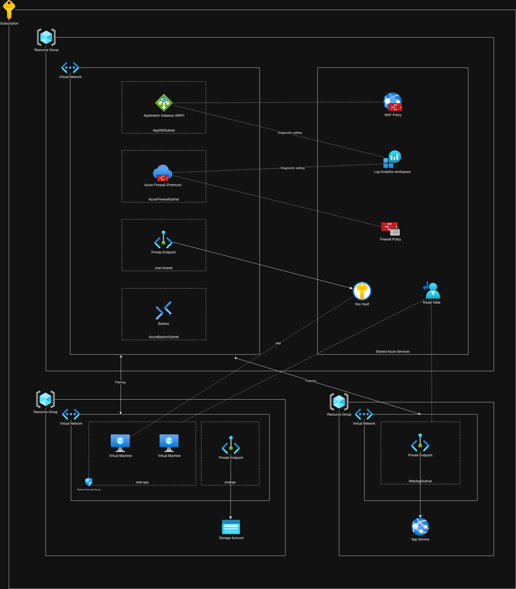

# Azure Zero Trust Lab

## Overview

This project is a hands-on Azure lab designed to validate Zero Trust principles in a hybrid enterprise application environment.

The lab simulates an organization operating both modern cloud-native applications and legacy business applications. The objective was to evaluate how Azure security and networking services can be combined to provide secure access, workload protection, identity-based authentication, and centralized monitoring.

### Key Scenarios

* Secure publishing of applications using Application Gateway and WAF
* Secure administrative access using Azure Bastion and Microsoft Entra ID
* Secret management using Managed Identity and Azure Key Vault
* Private connectivity to PaaS services through Private Endpoints
* Centralized logging and monitoring using Log Analytics and KQL
* Traffic inspection and network segmentation using Azure Firewall Premium
* Hub-Spoke network architecture implementation

---

## Conceptual Architecture

### User Access

Users access both modern and legacy applications through Application Gateway with WAF protection.

* Modern applications are hosted on Azure App Service.
* Legacy business applications remain on virtual machines to represent workloads that have not yet been fully modernized.
* Application data is stored in Azure Storage Account.
* Workloads retrieve secrets from Azure Key Vault using Managed Identity.

### Administrative Access

Infrastructure administrators securely access virtual machines through Azure Bastion using Microsoft Entra ID authentication.

This eliminates the need for public IP addresses and reduces the attack surface for administrative access.

### Monitoring and Logging

Application Gateway and Azure Firewall send diagnostic logs to Log Analytics Workspace.

Security analysts can investigate events and monitor security posture using KQL queries.

---

## Architecture Components

| Category             | Services                                  |
| -------------------- | ----------------------------------------- |
| Identity             | Microsoft Entra ID, Managed Identity      |
| Network Security     | Azure Firewall Premium, NSG, UDR          |
| Application Security | Application Gateway, WAF Policy           |
| Private Access       | Private Endpoint                          |
| Secret Management    | Azure Key Vault                           |
| Monitoring           | Log Analytics Workspace, KQL              |
| Administration       | Azure Bastion                             |
| Compute              | Azure Virtual Machines, Azure App Service |
| Storage              | Azure Storage Account                     |

---

## Detailed Architecture

The environment follows a Hub-Spoke architecture pattern.

### Hub Network

The hub network hosts shared security and management services:

* Azure Firewall Premium
* Azure Bastion
* Shared Private Endpoints
* Log Analytics Workspace
* Key Vault

### Spoke Network

The spoke network hosts internal workloads:

* Management Server
* Legacy Application Server
* Storage Account access through Private Endpoint

### Application Network

The application network hosts:

* Azure App Service
* Private Endpoint for secure application connectivity

---

## Security Design Highlights

### Identity-Based Access

* Microsoft Entra ID authentication
* Managed Identity for workload authentication
* Elimination of embedded credentials

### Network Segmentation

* Hub-Spoke architecture
* User Defined Routes (UDR)
* Centralized traffic inspection through Azure Firewall Premium

### Private Connectivity

* Key Vault accessed through Private Endpoint
* Storage Account accessed through Private Endpoint
* Reduced exposure of PaaS services to the public internet

### Monitoring

* Centralized logging using Log Analytics Workspace
* Diagnostic Settings integration
* KQL-based investigation and monitoring

---

## Lessons Learned

Through this lab, I gained practical experience with:

* Designing Azure Hub-Spoke architectures
* Implementing Zero Trust security controls
* Managing workload identities using Managed Identity
* Securing PaaS services with Private Endpoints
* Building centralized monitoring and logging solutions
* Understanding the operational trade-offs between modern and legacy workloads
